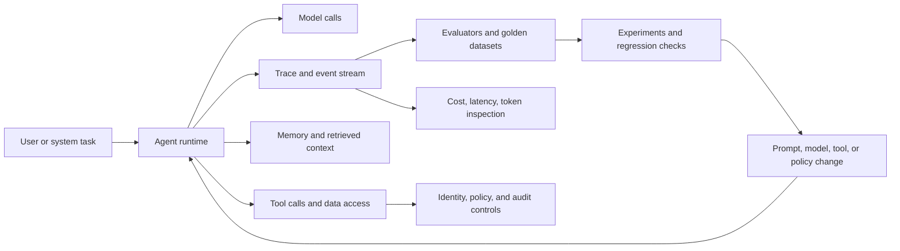

# Enterprise Agents Are Becoming Platforms, Not Demos

Enterprise agent adoption is entering a less glamorous, more important phase. The question is no longer whether a team can wire a model to tools and produce an impressive demo. The question is whether the agent can be operated: traced, evaluated, governed, secured, versioned, scaled, and made economically tolerable under real workload patterns.

That shift is visible across three current signals. AWS is packaging agent observability as a first-class operational surface with Amazon CloudWatch Omni. Amazon Bedrock AgentCore is positioning agents as production platform workloads with runtime, identity, gateway, observability, evaluation, and security controls. Fireworks' Ember-1 launch shows why agent economics are becoming architectural: long reasoning traces and multi-turn context growth can turn a working prototype into an expensive system.

The thesis for platform leaders is simple: agents are not just applications. They are operated decision systems. Treating them like scripts leaves teams blind to behavior, exposed on permissions, and surprised by cost. Treating them like platforms creates a control plane for quality, safety, and unit economics.

## What Changed

Traditional software operations centers on relatively deterministic services. A request enters, code executes, dependencies respond, and teams inspect logs, metrics, traces, errors, saturation, and latency. Agents add several failure modes that normal observability does not explain well.

An agent can choose the wrong tool, choose the right tool at the wrong time, retrieve weak context, drift after a prompt change, become more expensive after a model switch, loop through unnecessary reasoning, or produce a plausible answer that passes system-health metrics while failing the user. The underlying service may be "green" while the agent is degrading.

That is why AWS describes CloudWatch Omni as observability, evaluation, and experimentation for AI agents, not just logging for LLM calls. The product announcement says Omni captures traces, includes built-in evaluators, compares prompt versions, builds test datasets from production traffic, runs experiments across configurations, and detects regressions. It also exposes traces in developer environments and a standalone web surface for operators. The important pattern is not the brand name; it is the convergence of traces, evals, experiments, prompt management, token usage, and latency into one operational workflow.

Bedrock AgentCore points in the same direction from the runtime side. Its product page frames production agents around framework/model flexibility, controlled tool calls, debugging, optimization, AWS security controls, and scale. The positioning is deliberately platform-shaped: build with multiple frameworks, connect to organizational tools, authorize calls, observe behavior, evaluate variants, and deploy with security controls. That does not make it vendor-neutral. It is clearly AWS-centric. But it is a strong signal that enterprise agent infrastructure is consolidating around control planes rather than loose application glue.

## The Operating Model

For enterprise teams, the practical architecture is an agent operations loop:

The key is that runtime, observability, evaluation, governance, and cost controls are not separate afterthoughts. They are the platform.

In a mature setup, every material agent execution should leave an inspectable trail: prompt version, model, tool decisions, tool inputs and outputs where policy allows, retrieval context, latency, token use, evaluator scores, and final outcome. Teams should be able to replay or compare behavior across prompt versions and model choices. They should also know which permissions were exercised and why.

This is where platform engineering becomes the right owner. Product teams can define the use case. ML and AI engineers can tune models and prompts. Security can define boundaries. But someone has to provide the paved road: runtime packaging, telemetry conventions, eval harnesses, deployment policy, secrets handling, identity, access control, incident response, and cost reporting.

## Why Cost Is Now Architecture

The Fireworks Ember-1 launch is useful because it frames cost as a behavior problem, not only a procurement problem. Fireworks argues that reasoning models can spend most generated tokens on internal reasoning and that multi-turn agent workloads magnify this because prior reasoning can be replayed into subsequent turns. Their specific claims should be treated as vendor claims, but the underlying mechanism is familiar to anyone operating agent loops: context grows, failed paths compound, and model choice interacts with task design.

For agents, cost controls are not just "use a cheaper model." They include:

- deciding which tasks need frontier reasoning and which can use specialized or smaller models
- using prompt caching or context reuse where provider support and workload shape allow it
- limiting unnecessary chain-of-thought-style verbosity in systems that expose or re-feed reasoning tokens
- measuring cost per successful task, not only cost per token
- routing low-risk steps to cheaper execution paths while preserving quality gates for high-risk decisions
- running evaluations before changing model, prompt, retrieval, or tool policy

The metric that matters is not the cheapest model call. It is cost per acceptable outcome under latency and safety constraints. That pushes cost management into architecture review, eval design, and platform telemetry.

## Comparison: Demo Stack vs Platform Stack

| Capability | Demo-oriented agent | Platform-operated agent |
|---|---|---|
| Runtime | Script, notebook, or single service | Managed runtime with deployment policy and rollback |
| Tool access | API keys and ad hoc connectors | Identity-aware gateway, least privilege, audit trail |
| Observability | Logs and occasional transcripts | Structured traces, spans, tool calls, token and latency inspection |
| Quality control | Manual spot checks | Golden datasets, evaluators, experiments, regression detection |
| Prompt changes | Edited inline | Versioned, compared, rolled back |
| Cost model | Tokens after the fact | Cost per task, routing, caching, model specialization |
| Security posture | Trust the agent path | Enforce policy at tool, data, and runtime boundaries |
| Ownership | App team improvises | Platform team provides paved road; app team owns use case |

## Production Tips

Start with traces before autonomy. If a team cannot inspect how the agent reached an answer, it is not ready for broader autonomy. A full trace should show model calls, tool choices, retrieval context, latency, token use, and failure points.

Treat evals as deployment gates. Unit tests will not catch most agent regressions. Build golden datasets from real tasks, use task-specific evaluators, and compare prompt/model/tool changes before release.

Separate tool authorization from model reasoning. The model can propose an action; the platform should decide whether that action is allowed. Authorization belongs in policy and gateway layers, not in prompt text alone.

Measure cost per successful workflow. Token totals are useful, but they miss retries, loops, escalations, and downstream manual repair. The business question is what an acceptable completed task costs.

Version the whole agent surface. Prompt, model, retrieval config, tool schema, policy, and evaluator set should be treated as release artifacts. Changing one without recording the rest makes regression analysis weak.

Do not overclaim portability. AgentCore's "any framework, any model" positioning is important, but platform adoption still creates strategic gravity around AWS services, identity, observability, and security controls. Call that out honestly.

## Operating Model Checklist

A production agent platform needs explicit operating ownership before more teams ship agents.

- **Service owner:** one team owns runtime health, deployment policy, rollback, and incident response for the agent platform.
- **Use-case owner:** the product or domain team owns task definition, acceptable outcomes, and user-facing quality.
- **Policy/control plane:** tool access, data boundaries, approvals, and side-effect permissions are enforced outside prompt text.
- **Eval gate:** prompt, model, retrieval, tool-schema, and policy changes pass task-specific regression checks before rollout.
- **Observability baseline:** each execution records trace IDs, model and prompt version, tool decisions, retrieval context, latency, tokens, evaluator output, and terminal status where policy permits.
- **Incident response:** teams can disable a route, revoke tool access, roll back prompt/model config, inspect recent traces, and notify affected owners.
- **Rollout gates:** new agents move from shadow mode to limited traffic to broader availability with quality, cost, and safety thresholds.
- **Cost/performance review:** routing decisions are measured by cost per successful workflow, not only model price or token totals.

## Caveats

CloudWatch Omni is generally available according to AWS, but teams still need to validate regional availability, supported framework coverage, data handling, and integration fit against their own environments. AgentCore's platform framing is strong, but it is AWS-centric and should not be described as a neutral portability layer. Fireworks Ember-1 is a vendor model release and should be cited as evidence of the cost/latency trend, not as independent proof that all reasoning models can safely halve token use.

The OpenAI prompt-caching source referenced in the original trend sweep was not independently verified from this environment. This brief therefore avoids specific OpenAI GPT-6 prompt-caching claims and keeps the safe broader claim: cost architecture is moving toward prompt caching, reasoning-effort controls, specialized models, context reuse, and task-level evaluation.

## The Takeaway

Enterprise agents are crossing the line from prototype to platform workload. The winners will not be the teams with the flashiest demo. They will be the teams that can operate agents with the same seriousness they bring to production services: observability, evals, access control, release discipline, and unit economics.

The strategic move for platform leaders is to build the agent control plane before agent count explodes. Once every team has a few agents in production, retrofitting traces, policy, evals, and cost governance becomes much harder. The right time to standardize is when the first high-value agents are being promoted from pilot to operated service.

## Sources

- AWS News Blog: "Introducing Amazon CloudWatch Omni: AI-powered observability for generative AI and agentic workloads" (September 22, 2026): https://aws.amazon.com/blogs/aws/introducing-amazon-cloudwatch-omni-ai-powered-observability-for-generative-ai-and-agentic-workloads/
- AWS: "Amazon Bedrock AgentCore" product page: https://aws.amazon.com/bedrock/agentcore/
- AWS News Blog: "Top announcements of the AWS Summit in New York, 2026" (June 17, 2026): https://aws.amazon.com/blogs/aws/top-announcements-of-the-aws-summit-in-new-york-2026/
- Fireworks AI Blog: "Introducing Ember-1" (September 23, 2026): https://fireworks.ai/blog/ember-1
