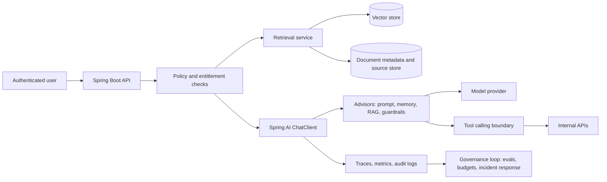

# Spring AI Is the Java Enterprise Bridge to Governed Agents

Java teams are moving past the first wave of chatbot experiments. The next set of questions is more operational: Can we connect models to enterprise documents without leaking data? Can we let a model call internal APIs without creating an unreviewable automation path? Can we test quality before release, observe failures after release, and pause a workflow when cost, latency, or risk crosses a threshold?

That is where Spring AI becomes strategically useful for enterprises already standardized on Java and Spring Boot. Spring AI does not turn a model into a safe autonomous worker by itself. It is not a complete LLM governance suite, a security boundary, or a substitute for evaluation and incident response. It is an application framework that brings AI integration into the same patterns Spring teams already use: starters, auto-configuration, dependency injection, portable abstractions, POJOs, fluent clients, advisors, observability integrations, RAG support, tool calling, vector-store adapters, and Model Context Protocol support.

That distinction matters. The fastest path to production AI in a Java enterprise is not to pretend that a framework can solve governance. It is to use the framework to make the application layer consistent, testable, observable, and replaceable, then surround that layer with evaluation, monitoring, access controls, data policy, cost controls, and rollback mechanisms.

The thesis is simple: Spring AI is the Java enterprise bridge to governed agents, not a governance platform by itself.

## Scope of This Piece

This post is deliberately narrow. It covers the **governance boundary** for Java agent and RAG workflows: what Spring AI gives you, what it does not give you, and what you have to build around it before the workflow touches production data or takes actions through tools.

It does not re-teach Spring AI architecture, which is covered in a separate piece in this series, and it does not cover enterprise agent operations and platform ownership, which is covered in another. The claim here is the narrow one: Spring AI supports application-level agent and RAG patterns, and production governance still requires evals, observability, policy, cost controls, model routing, and rollout and rollback systems outside the framework.

## Why Java Teams Need a Bridge

Most enterprise AI programs start with one of two prototypes. The first is a thin chatbot over a hosted model. The second is a Python-heavy RAG or agent proof of concept that works in a lab but is awkward to operate beside the systems that own customer data, entitlements, audit logs, and deployment pipelines.

The prototype may prove that an LLM can summarize a policy, classify a ticket, or draft a support answer. It usually does not prove that the workflow can be governed. Production teams still need to answer mundane but decisive questions:

- Which documents were retrieved, under which metadata filters, for which user?
- Which tools was the model allowed to call, and what arguments were passed?
- Which model handled the request, with what latency and cost profile?
- Which evaluations must pass before a prompt, retrieval strategy, model version, or tool schema changes?
- Which traces and audit logs are retained, for how long, under which access policy?
- Which threshold pauses or rolls back the workflow?

For many Java organizations, the hardest part is not writing the first model call. It is fitting AI into the operating model they already use for critical applications. Spring AI is useful because it lets those teams start from familiar Spring Boot application architecture instead of creating a parallel AI stack with unfamiliar lifecycle, dependency, deployment, and observability conventions.

Spring AI describes its goal as applying Spring ecosystem principles such as portability, modular design, and POJOs to AI engineering. Its reference documentation frames the integration problem as connecting enterprise data and APIs with AI models. That is exactly the enterprise boundary where agent and RAG systems become serious.

## What Spring AI Actually Gives You

Spring AI provides portable APIs across chat models, embedding models, image models, audio models, moderation models, vector stores, structured output converters, document ingestion, tool and function calling, observability, model evaluation utilities, advisors, chat memory, RAG, and MCP integration. The value is not that every abstraction is magically provider-neutral in every production detail. The value is that common AI application concerns become Spring-managed components rather than one-off scripts.

For senior Spring engineers, the ergonomics are familiar:

- Starters and auto-configuration wire model clients and vector stores into the application context.
- `ChatClient` provides a fluent API similar in spirit to `WebClient` and `RestClient`.
- Structured outputs map model responses into Java types.
- Advisors encapsulate recurring prompt, memory, retrieval, and transformation patterns.
- Tool calling lets the model request client-side functions or tools.
- Vector-store abstractions let teams change storage backends with less application rewrite.
- RAG and document ETL features connect enterprise content to generation workflows.
- Observability hooks expose AI operations to the monitoring stack.
- Evaluation utilities create a starting point for hallucination and output-quality checks.
- MCP support lets Spring applications consume MCP servers or expose Spring services to the broader AI tool ecosystem.

That set of features is enough to build useful workflows such as internal documentation Q&A, ticket triage, knowledge-base answer drafting, contract clause lookup, sales enablement retrieval, or guided operations assistants. It is also enough to get into trouble if the surrounding controls are missing.

The correct mental model is: Spring AI standardizes the application integration layer. Governance still requires a system around the application.

## Reference Architecture: Governed RAG and Tool Calling in Spring

A production Java agent or RAG system is usually not one component. It is a workflow that joins identity, retrieval, prompt construction, model invocation, tool execution, logging, evaluation, monitoring, and rollback.



In this shape, Spring AI is centered on the application path: `ChatClient`, advisors, retrieval, vector-store adapters, model clients, and tool calls. It should not own every governance decision. Identity should remain in the enterprise identity layer. Authorization should be enforced before retrieval and tool execution. Audit retention should follow enterprise policy. Cost and latency budgets should be measured by workflow. Incident response should live in runbooks, alerting, and operational ownership.

The advantage of using Spring AI is that this workflow can be built like a Spring application rather than a detached AI service. The same teams that know Spring Security, Spring Boot configuration, Micrometer, Testcontainers, CI gates, and deployment pipelines can reason about the AI path.

## Code Example: A Minimal Governed RAG Endpoint

The following example is intentionally small. It shows the shape of a Spring-managed RAG endpoint with a policy check, metadata-filtered retrieval, and a traceable `ChatClient` call. Real production code should add richer exception handling, rate limits, prompt versioning, eval gates, and audit retention.

```java
package com.example.ai.support;

import java.util.List;

import org.springframework.ai.chat.client.ChatClient;
import org.springframework.ai.document.Document;
import org.springframework.ai.vectorstore.SearchRequest;
import org.springframework.ai.vectorstore.VectorStore;
import org.springframework.web.bind.annotation.PostMapping;
import org.springframework.web.bind.annotation.RequestBody;
import org.springframework.web.bind.annotation.RestController;

@RestController
class SupportAssistantController {

    private final ChatClient chatClient;
    private final VectorStore vectorStore;
    private final EntitlementService entitlements;
    private final AuditLog auditLog;

    SupportAssistantController(
            ChatClient.Builder chatClientBuilder,
            VectorStore vectorStore,
            EntitlementService entitlements,
            AuditLog auditLog) {
        this.chatClient = chatClientBuilder.build();
        this.vectorStore = vectorStore;
        this.entitlements = entitlements;
        this.auditLog = auditLog;
    }

    @PostMapping("/internal/support/answer")
    SupportAnswer answer(@RequestBody SupportQuestion request) {
        entitlements.assertCanAccessAccount(request.userId(), request.accountId());

        List<Document> documents = vectorStore.similaritySearch(SearchRequest.builder()
                .query(request.question())
                .topK(6)
                .filterExpression("accountType == 'enterprise' && region == 'us'")
                .build());

        String context = documents.stream()
                .map(Document::getText)
                .reduce("", (left, right) -> left + "\n---\n" + right);

        String answer = chatClient.prompt()
                .system("You answer support questions from approved context only. "
                        + "If the context is insufficient, say what is missing.")
                .user(user -> user.text("Question:\n{question}\n\nApproved context:\n{context}")
                        .param("question", request.question())
                        .param("context", context))
                .call()
                .content();

        auditLog.recordRagAnswer(request.userId(), request.accountId(), request.question(), documents);
        return new SupportAnswer(answer);
    }
}

record SupportQuestion(String userId, String accountId, String question) {}
record SupportAnswer(String answer) {}

interface EntitlementService {
    void assertCanAccessAccount(String userId, String accountId);
}

interface AuditLog {
    void recordRagAnswer(String userId, String accountId, String question, List<Document> documents);
}
```

The important design choice is not the syntax. It is the boundary. Retrieval happens after entitlement checks. Metadata filtering narrows the candidate context. The system instruction limits the answer to approved context. Retrieved document identifiers can be written to audit logs. Those are application controls that make later evaluation and incident analysis possible.

This is also where teams should be honest about what the code does not prove. A prompt instruction is not a security control. A metadata filter is only as good as the ingestion pipeline and metadata quality behind it. Audit logging only helps if it is retained, searchable, and protected from tampering.

## Connecting Enterprise Data and APIs

Spring AI's most enterprise-relevant feature set sits around data and API connectivity: document ETL, vector stores, metadata filters, structured output, tool calling, and MCP.

For RAG, document ingestion must be treated as a data product. Teams need clear ownership for parsing, chunking, embedding, versioning, metadata enrichment, deletion, and re-indexing. The application should know which document versions are eligible for which users and workflows. The vector store should not become a permission bypass.

For tool calling, the model should never get a broad internal API credential and free-form execution surface. Tools should be narrow, typed, logged, and policy checked. A good tool boundary looks like a product API: named capability, explicit schema, validation, idempotency where possible, authorization, rate limits, and audit logs.

```java
package com.example.ai.tools;

import org.springframework.ai.tool.annotation.Tool;
import org.springframework.stereotype.Component;

@Component
class OrderTools {

    private final OrderService orders;
    private final EntitlementService entitlements;

    OrderTools(OrderService orders, EntitlementService entitlements) {
        this.orders = orders;
        this.entitlements = entitlements;
    }

    @Tool(description = "Return shipment status for an order the current user is allowed to view")
    ShipmentStatus shipmentStatus(String userId, String orderId) {
        entitlements.assertCanViewOrder(userId, orderId);
        return orders.lookupShipmentStatus(orderId);
    }
}

record ShipmentStatus(String orderId, String carrier, String status, String lastUpdatedAt) {}

interface OrderService {
    ShipmentStatus lookupShipmentStatus(String orderId);
}

interface EntitlementService {
    void assertCanViewOrder(String userId, String orderId);
}
```

MCP adds another important integration path. It gives organizations a protocol for exposing tools and context to AI applications across clients and servers. In a Spring environment, MCP support can help teams expose Spring services to AI workflows or consume external MCP servers. That is useful, but it should be governed like any other integration surface. The question is not only "Can the model discover a tool?" It is "Who approved this tool, which data can it touch, how is it monitored, and how do we revoke it?"

## Evaluation Is a Delivery Loop, Not a Launch Checkbox

Spring AI includes model evaluation utilities to help evaluate generated content and protect against hallucinated responses. That is a starting point, not a complete quality system.

In production, evaluation should be a delivery loop that runs before and after release. A useful loop includes:

- Golden datasets for each workflow, with representative easy, hard, ambiguous, and adversarial examples.
- Retrieval checks that verify whether the right documents were selected before judging generation quality.
- Hallucination checks that compare claims against retrieved context or authoritative APIs.
- Regression tests for prompts, tool schemas, model versions, chunking strategies, embedding models, and vector-store changes.
- Cautious LLM-as-judge usage with calibration, sampling, and human review for high-impact workflows.
- Cost and latency benchmarks by use case, not by generic model preference.
- Release gates that block or require review when quality, cost, latency, or safety indicators regress.

Anthropic's discussion of embedded evaluation is useful here as a signal about industry direction: evaluation is becoming more continuous, more independent, and more tied to how models are actually used. OpenAI's safety-case discussion similarly emphasizes evidence-backed arguments, technical safeguards, monitoring, thresholds, dissent, approvals, pausing, rollback, and incident learning. Those sources are about frontier model development and safeguards, not a direct recipe for every enterprise RAG app. But they point to the same operational pattern: serious AI work requires explicit evidence, monitoring, escalation, and rollback.

For application teams, the practical version is smaller but still rigorous. Every Spring AI workflow should have a release contract:

| Gate | Example Question | Release Action |
| --- | --- | --- |
| Retrieval quality | Did the workflow retrieve the expected source documents? | Block release if recall drops below the agreed threshold for the workflow. |
| Generation quality | Are answers grounded in retrieved context? | Require review for unsupported claims or missing uncertainty language. |
| Tool safety | Did tool calls use valid arguments and approved permissions? | Block release on unauthorized or malformed tool invocation. |
| Cost and latency | Did p95 latency or per-task cost exceed the budget? | Route to a cheaper model, reduce context, or pause rollout. |
| Monitoring | Are traces, logs, alerts, and dashboards live? | Fail closed if the workflow cannot be monitored. |
| Rollback | Can prompt, model, tool, and index changes be reverted? | Do not release without a tested rollback path. |

The best evaluation suites are boring. They run in CI. They are tied to product workflows. They produce trend lines. They catch regressions before a demo becomes a customer incident.

## Operational Governance Around Spring AI

Operational governance is the layer that prevents an AI application from becoming an unaccountable black box. It should be designed before the workflow handles sensitive data or takes action through tools.

Minimum governance for a Spring AI production workflow should include:

- Tracing for model calls, retrieval, advisors, tool calls, latency, errors, token usage, and model routing decisions.
- Audit logs for user identity, retrieved source IDs, tool invocation arguments, policy decisions, and generated outputs where retention policy allows.
- Data controls for document classification, tenant isolation, metadata quality, deletion, encryption, and retention.
- Abuse monitoring for unusual usage patterns, prompt injection attempts, credential exposure attempts, and suspicious tool-call sequences.
- Incident response runbooks with severity levels, on-call ownership, pause controls, customer notification criteria, and postmortem expectations.
- Budget controls for token spend, vector-store costs, embedding jobs, retries, and premium-model routing.
- Access controls for model credentials, tool registration, prompt changes, eval overrides, and trace access.
- Rollback and pause thresholds for quality, safety, latency, cost, and abuse signals.

Anthropic's Enterprise Frontier Safeguards announcement is relevant because it frames a concrete enterprise tension: organizations want strong monitoring for misuse, but they also need control over sensitive data, keys, storage, access policies, and audit logging. Whether or not a team uses that specific offering, the architecture lesson applies broadly. Enterprise AI controls are not just policy statements. They are data-plane and control-plane decisions.

OpenAI's model-distillation report adds another practical lesson: adversarial behavior can be coordinated, adaptive, and cross-account. Enterprise application teams should assume that prompt injection, tool-output manipulation, credential leakage attempts, and extraction attempts will evolve. The response cannot be a single regex. It needs layered controls, detection, enforcement, and information sharing across security, platform, and application teams.

## Cost and Performance Are Architecture Decisions

Cost and latency are not procurement afterthoughts. They shape the architecture of an AI workflow.

Spring AI's portability helps because teams can route across model providers and model types more intentionally, but portability does not eliminate tradeoffs. A workflow may need a premium model for ambiguous legal interpretation, a smaller model for classification, a dedicated embedding model for retrieval, and streaming for user-facing response time. The right design depends on business value, latency tolerance, risk, and expected volume.

Teams should measure cost and performance by workflow:

- What is the acceptable p50 and p95 latency for this user path?
- What is the maximum cost per completed business task?
- Which requests can use a cheaper model or cached response?
- Which requests require larger context windows, better retrieval, or human review?
- Which embeddings and vector-store choices produce acceptable retrieval quality at expected scale?
- Which context should be summarized, filtered, or dropped before model invocation?
- Where does streaming improve perceived latency without hiding backend failure modes?

Caching can help for stable public content, repeated classifications, or deterministic retrieval steps. It can be dangerous when answers depend on user entitlements, fresh data, or regulated context. Context-window expansion can improve recall but increase cost and introduce more irrelevant material. Model routing can reduce spend but complicate evaluation. Every optimization should be evaluated against the actual workflow, not a generic benchmark.

## Spring AI Compared With Governance Layers

Spring AI is best understood as part of a stack. It overlaps with some evaluation and observability concerns, but it should not be treated as the whole operating model.

| Concern | Spring AI Helps With | Additional Layer Still Needed |
| --- | --- | --- |
| Model access | Portable chat, embedding, moderation, and provider APIs | Provider risk review, credential governance, routing policy |
| RAG | Document ETL, vector-store abstractions, metadata filters, advisors | Data classification, entitlements, index lifecycle, deletion guarantees |
| Tool calling | Typed tool and function integration and Spring-managed components | Tool approval, least privilege, rate limits, transaction safety, audit review |
| Observability | AI operation visibility through framework hooks | Enterprise SIEM, alerting, retention, incident response, abuse correlation |
| Evaluation | Utilities for output evaluation and hallucination checks | Golden datasets, CI gates, human review, LLM-judge calibration, release policy |
| MCP | Client and server integration with the AI tool ecosystem | Tool registry governance, revocation, security review, cross-team ownership |
| Governance | Makes app behavior more consistent and inspectable | Policy, controls, approvals, budgets, rollback, audit, compliance ownership |

This is why Spring AI is a bridge. It gives Java teams a coherent application foundation. It does not remove the need for platform and governance engineering.

## Practical Production Checklist

Before moving a Spring AI workflow from pilot to production, run it through a checklist that treats governance as part of delivery.

1. **Define the workflow.**
   Name the business task, users, data sources, tools, success criteria, failure modes, and owners.

2. **Classify the data.**
   Identify sensitive fields, regulated records, tenant boundaries, retention rules, and deletion requirements before indexing or prompting.

3. **Lock down retrieval.**
   Enforce authorization before retrieval, use metadata filters, log source IDs, test retrieval quality, and verify deletion behavior.

4. **Narrow the tools.**
   Prefer small, typed, policy-checked tools over broad API access. Log arguments and outcomes. Make destructive actions explicit and reviewable.

5. **Build evals early.**
   Create golden datasets, regression tests, hallucination checks, tool-call tests, and release thresholds before broad rollout.

6. **Instrument the path.**
   Trace model calls, retrieval, tool calls, routing, token usage, latency, errors, and safety events. Ensure monitoring fails closed for critical workflows.

7. **Set budgets.**
   Define per-workflow cost and latency budgets. Decide when to route, cache, stream, degrade, pause, or require human review.

8. **Govern changes.**
   Version prompts, tool schemas, retrieval strategies, model selections, and eval suites. Require approval for high-impact changes.

9. **Prepare incident response.**
   Define severity levels, pause controls, escalation paths, customer notification criteria, transcript retention, and postmortem ownership.

10. **Test rollback.**
    Practice reverting prompt, model, index, tool, and routing changes. A workflow that cannot be rolled back is not production-ready.

## The Bottom Line

Spring AI matters because it lets Java enterprises build AI applications without abandoning the engineering model that already runs much of their business software. It brings model access, RAG, tool calling, structured outputs, advisors, observability hooks, evaluation utilities, vector-store integration, and MCP into familiar Spring Boot patterns.

But governed agents are not created by a framework alone. They are created by the combination of framework ergonomics, disciplined application boundaries, evaluation loops, observability, data controls, security monitoring, budgets, access control, and incident response.

For senior Java teams, the right question is not "Can Spring AI make us agentic?" The better question is: "Which workflow can we make useful, measurable, observable, reversible, and governed?"

Start there. Pick one Java agent or RAG workflow. Assess it against evals, traces, data policy, model routing, cost and latency budget, and rollback thresholds. If those controls are missing, Spring AI can still help you build the application, but you are not ready to call it governed.

## Sources

- Spring AI project page: https://spring.io/projects/spring-ai
- Spring AI reference documentation: https://docs.spring.io/spring-ai/reference/
- Anthropic, "Partnering with Accenture on embedded evaluation": https://www.anthropic.com/news/accenture-embedded-evaluation
- Anthropic, "Developing Enterprise Frontier Safeguards with our customers": https://www.anthropic.com/news/enterprise-frontier-safeguards
- OpenAI, "Towards safety cases for frontier AI training": https://openai.com/index/towards-safety-cases-for-frontier-ai-training/
- OpenAI, "Disrupting a coordinated model-distillation campaign": https://openai.com/index/disrupting-a-coordinated-model-distillation-campaign/

_Vendor announcements from Anthropic and OpenAI are cited as signals about industry direction, not as neutral proof of efficacy. No adoption metrics or benchmark numbers are claimed in this article._
