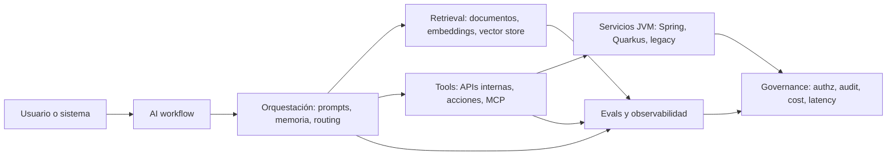

# El stack Java para AI ya no es una demo

Cómo elegir entre LangChain4j, MCP Java, ADK Kotlin, Spring AI y Quarkus sin comprar hype.

La pregunta equivocada es: "¿cuál es el stack Java oficial para AI?". No existe. Y probablemente no conviene que exista.

La pregunta útil es otra: qué parte del workflow necesita orquestación LLM, qué parte necesita retrieval, qué parte debe exponerse como tool, qué parte queda detrás de seguridad enterprise y qué parte debe medirse con evals, tracing, costo y latencia antes de llegar a producción.

La presión de producto sí cambió. OpenAI está empujando GPT-6 e Intelligent UI como una experiencia donde la conversación puede componer texto, visuales, formularios, gráficos y acciones interactivas. Eso no prueba adopción JVM. Pero si cambia la expectativa del usuario final: cada producto enterprise va a recibir presión para tener copilotos, interfaces conversacionales, búsqueda semántica, workflows asistidos y acciones dentro del producto.

Para equipos Java, esto no significa reescribir todo en Python. Significa que los sistemas JVM vuelven al centro porque ahí viven datos, transacciones, identidad, permisos, auditoría, colas, SLAs y restricciones regulatorias. El valor no está en hacer otra demo de chat. Está en conectar modelos a sistemas reales sin romper los límites que hacen confiable a una plataforma enterprise.

## Por qué Java vuelve al centro

Java no ganó la primera narrativa de AI generativa. La narrativa pública se movió alrededor de Python, notebooks, SDKs de proveedores y frameworks de prototipado. Pero las AI features que sobreviven al prototipo suelen necesitar cosas donde el ecosistema JVM ya es fuerte:

- Identidad, autorización y políticas de acceso.
- Integración con APIs internas y sistemas legacy.
- Transacciones, consistencia, mensajería y retries.
- Observabilidad con logs, metrics, traces y correlación por request.
- Operación en Spring Boot, Quarkus, Kubernetes, service meshes y pipelines existentes.
- Controles de seguridad para datos sensibles, tools y acciones con impacto real.

InfoQ viene agrupando señales en esa dirección: LangChain4j aparece en roundups Java, MCP ya tiene tratamiento específico en el mundo Java, ADK incluye Java/Kotlin, Quarkus mantiene una extensión LangChain4j con RAG, tools, MCP, A2A y observabilidad, y Spring AI se posiciona como framework de aplicaciones AI con APIs portables, vector stores, tools, advisors, observabilidad y evaluación.

La conclusión no es "usa todo". La conclusión es que el stack JVM para AI se está formando como una constelación: librerías de AI services, protocolos para tools, frameworks de agentes, runtime/server frameworks, seguridad y observabilidad.

## Mapa mental del stack

Un sistema AI en Java suele mezclar cinco capas. Separarlas evita que la elección de framework oculte los riesgos reales.



LangChain4j encaja cuando el problema principal es integrar modelos, memoria, tools, RAG y AI services directamente en aplicaciones Java. La documentación lo presenta como una forma de acceder a LLMs y vector stores con una API unificada, con integraciones para Quarkus, Spring Boot y Helidon, y con dos direcciones importantes: Java llamando modelos y modelos llamando código Java.

MCP Java encaja cuando el problema principal es estandarizar cómo los modelos y agentes descubren y llaman herramientas. El repositorio oficial del Java SDK lo describe como una implementación para servidores y clientes MCP, con patrones sincronos y asincronos, soporte de streaming, transports como STDIO, HTTP/SSE/Streamable HTTP según implementación, JSON vía Jackson, APIs basadas en Reactive Streams y hooks de autorización para servidores. Además, el proyecto está mantenido en colaboración con Spring AI y expone integraciones Spring para cliente/servidor.

ADK Java/Kotlin encaja cuando el problema principal ya no es una llamada aislada a modelo sino un agente o workflow de agentes. La documentación de ADK lo posiciona como un framework open source para construir, depurar, evaluar y desplegar agentes en escala enterprise, con soporte para Python, TypeScript, Go, Java y Kotlin. La página de inicio muestra APIs Java y Kotlin, graph workflows, multi-agent workflows, evaluación, deployment, observabilidad y control de contexto.

Spring AI encaja cuando el equipo ya vive en Spring Boot y quiere que AI parezca una extensión natural del stack: ChatClient, auto-configuración, starters, modelos, embeddings, vector stores, tools/function calling, structured outputs, advisors, memoria, RAG, observabilidad y evaluación. Su propia página resume el problema como conectar datos y APIs enterprise con modelos AI.

Quarkus LangChain4j encaja cuando el equipo quiere AI en servicios Quarkus con startup rápido, bajo footprint, native image y una experiencia declarativa. Su documentación destaca AI services con interfaces/anotaciones, soporte de tools, memoria, RAG, observabilidad, Dev UI, Dev Services y protocolos como MCP y A2A. La referencia oficial de GraalVM Native Image es útil como criterio operativo: el beneficio no acelera al LLM, pero puede bajar cold starts, memoria y superficie de contenedor en gateways, tool servers MCP o workers cortos; el costo es probar temprano reflection, recursos y metadata de SDKs AI.

Spring/PQC no es un framework de agentes, pero sí importa en una pieza sobre AI enterprise. AI aumenta la superficie de datos, secretos, prompts, documentos, embeddings y acciones automatizadas. La conversación sobre criptografía post-cuantica en Spring Boot, y la llegada de PQC en Java moderno según la cobertura de InfoQ, no significa que todo agente necesite PQC hoy. Significa que seguridad criptográfica, rotación, TLS, firma, key management y compliance deben vivir en la misma conversación que RAG y tool calling.

## Tabla comparativa

| Componente | Cuándo usarlo | Riesgo principal | Señal de madurez | Integración JVM |
| --- | --- | --- | --- | --- |
| LangChain4j | Chatbots, RAG, AI services y tool calling dentro de apps Java | Convertir una demo de prompt en arquitectura sin boundaries | Docs activas, integraciones Spring Boot/Quarkus/Helidon, ejemplos y comunidad | Alta: Java-first, APIs directas, integraciones framework |
| MCP Java SDK | Exponer o consumir tools de forma estandarizada entre agentes/modelos y sistemas internos | Exponer tools con permisos demasiado amplios o sin autorización/auditoría | SDK oficial, Maven, conformance tests parciales, colaboración Spring AI | Alta: cliente/servidor Java, Servlet/JDK HttpClient, Spring AI |
| ADK Java/Kotlin | Workflows agénticos, multi-agent, graph workflows, evaluación y deployment | Usar agentes donde basta una llamada determinista o un job tradicional | Docs multi-lenguaje, runtime, evaluación, observabilidad, deployment | Media-alta: APIs Java/Kotlin, pero decisión depende de runtime/cloud |
| Spring AI | Equipos Spring Boot que quieren modelos, RAG, vector stores, tools, observabilidad y evals con idioms Spring | Acoplarse a auto-config sin diseñar políticas de datos/tools | Proyecto Spring 2.x, Initializr, starters, modelo portable | Muy alta para equipos Spring |
| Quarkus LangChain4j | Servicios Quarkus AI-native, bajo footprint, native image, Dev UI y RAG rápido | Sobrecargar servicios latencia-sensibles con workflows LLM no aislados | Extensión Quarkiverse con guías, RAG, MCP, guardrails, observabilidad | Muy alta para equipos Quarkus |
| Spring/PQC y seguridad JVM | Sistemas regulados, datos sensibles, secretos, firmas, TLS, compliance | Tratar AI como excepción a controles existentes | Cobertura InfoQ sobre PQC/Java y patrones Spring Boot | Alta como capa transversal, no como orquestador AI |

## Decisión por caso de uso

Para un chatbot interno sobre documentación, empieza por retrieval y permisos. Spring AI o LangChain4j pueden resolver mucho del plumbing: chat client, embeddings, vector store, memoria y structured outputs. La pregunta crítica no es qué vector database está de moda. Es qué documentos puede ver el usuario, cómo se actualiza el índice, cómo se cita la fuente, cómo se detecta una respuesta sin evidencia y qué logs quedan para auditoría.

Para RAG de conocimiento técnico, separa la ingestion del query-time augmentation. La ingestion debe tener ownership, versionado de documentos, normalización, chunking reproducible y reindexado controlado. Query-time debe medir retrieval hits, documentos citados, latencia, tokens y fallback cuando no hay evidencia. Un RAG que no puede decir "no tengo evidencia suficiente" no está listo para decisión enterprise.

Para tool-calling workflows, diseña primero el contrato de tools. MCP Java puede ayudar a estandarizar cómo un agente descubre y llama herramientas, pero no decide por ti qué herramienta puede ejecutar qué acción. Define scopes, idempotencia, dry-run, confirmación humana para acciones sensibles, rate limits y payloads auditables. Una tool que crea tickets es distinta de una tool que reinicia producción.

Para agentes operativos, considera ADK o patrones agénticos solo cuando el workflow realmente necesita planificación, pasos múltiples, memoria, delegación o recuperación de fallos. Muchos casos no necesitan agente: necesitan un formulario mejor, un clasificador, un job programado o una regla de decisión determinista. Cuando sí necesitas agente, exige evaluación, observabilidad, replay y rutas de cancelación.

Para AI embebida en APIs existentes, Spring AI o Quarkus LangChain4j suelen ser el camino pragmático. Mantienen el desarrollo cerca de la aplicación, usan configuración del framework y conectan con observabilidad existente. La trampa es meter demasiada lógica LLM dentro del request path crítico. Para workflows lentos o costosos, usa colas, jobs asincronos y estados persistidos.

## Ejemplos de código

Un ejemplo mínimo de Spring AI ilustra el patrón: mantener el cliente como una dependencia normal de la aplicación, no como un script suelto.

```java
import org.springframework.ai.chat.client.ChatClient;
import org.springframework.stereotype.Service;

@Service
public class SupportAnswerService {
    private final ChatClient chatClient;

    public SupportAnswerService(ChatClient.Builder builder) {
        this.chatClient = builder.build();
    }

    public String draftAnswer(String customerQuestion) {
        return chatClient.prompt()
            .system("Answer as a support engineer. If evidence is missing, say so.")
            .user(customerQuestion)
            .call()
            .content();
    }
}
```

Un ejemplo de LangChain4j muestra el patrón de AI Service: una interfaz clara que puede versionarse y testearse como boundary de aplicación.

```java
import dev.langchain4j.service.SystemMessage;
import dev.langchain4j.service.UserMessage;

interface IncidentAssistant {
    @SystemMessage("Summarize incidents with evidence, impact, suspected cause, and next action.")
    String summarize(@UserMessage String incidentTimeline);
}
```

Un ejemplo Kotlin inspirado en ADK muestra cómo un agente debe declararse con nombre, modelo, instrucción y tools explícitas, no con herramientas globales invisibles.

```kotlin
import com.google.adk.kt.agents.LlmAgent
import com.google.adk.kt.tools.GoogleSearchTool

val agent = LlmAgent(
    name = "release_risk_reviewer",
    model = Gemini(name = "gemini-flash-latest"),
    instruction = Instruction("Review release notes and identify operational risks."),
    tools = listOf(GoogleSearchTool())
)
```

Estos snippets no son una arquitectura completa. Ese es el punto. El código fácil es llamar al modelo. El trabajo serio es el boundary alrededor: datos permitidos, tools permitidas, evals, fallback, observabilidad y costos.

## Riesgos de producción

El primer riesgo es latencia. Un request tradicional puede depender de base de datos y una o dos APIs internas. Un request AI puede agregar retrieval, reranking, llamada a modelo, tool calls y streaming. Mide latencia por workflow, no solo por request de modelo.

El segundo riesgo es costo. Routing por modelo importa porque no todo paso necesita el modelo más caro. Anthropic viene enfatizando modelos segmentados por velocidad/costo/capacidad y programas enterprise de verificación; más allá del vendor, la señal es correcta: enruta por tarea, riesgo y latencia.

El tercer riesgo es prompt/tool injection. Si un documento recuperado puede instruir al modelo a ignorar políticas, y el modelo puede llamar tools, tu RAG se volvió superficie de ataque. Trata documentos como datos no confiables, separa instrucciones de contenido recuperado y limita tools por usuario/contexto.

El cuarto riesgo es observabilidad. Necesitas trazas de modelo, la versión del prompt template, documentos recuperados, tool calls, errores, retries, tokens, costo aproximado y decisión final. Sin eso no puedes depurar, evaluar ni explicar incidentes.

El quinto riesgo es evaluación. Versiona prompts, tools y datasets de evaluación igual que versionas APIs. Una suite mínima debe cubrir respuestas con evidencia, negativas cuando no hay evidencia, permisos, inputs maliciosos, costos y regresiones de latencia.

## Tips de producción

- Empieza por el workflow y sus boundaries antes de elegir framework.
- Define qué puede decidir el modelo, qué puede sugerir y qué nunca puede ejecutar sin aprobación.
- Versiona prompts, tools, schemas y eval suites.
- En RAG, aplica filtros de metadata/ACL antes de recuperar contexto: si el usuario no puede leer el documento original, tampoco debería verlo por embeddings.
- Instrumenta desde el prototipo: modelo, tokens, retrieval hits, tool calls, latencia, errores y costo.
- Usa feature flags y rollout gradual para AI features con impacto en usuarios reales.
- Trata GitHub Trending y Hacker News como señales de atención, no como evidencia de madurez técnica.
- Evita mezclar seguridad post-cuántica, agentes y RAG en una sola decisión de compra. Son capas distintas.

## CTA técnico

Antes de elegir LangChain4j, MCP Java, ADK Kotlin, Spring AI o Quarkus LangChain4j, dibuja el caso de uso en una página:

1. Usuario o sistema que inicia el workflow.
2. Datos que puede consultar.
3. Decisiones permitidas al modelo.
4. Tools disponibles y permisos.
5. Evidencia requerida para responder.
6. Evals mínimos antes de release.
7. Observabilidad y auditoría necesarias.
8. Presupuesto de latencia y costo.

Si no puedes llenar esa página, todavía no estás eligiendo stack. Estás eligiendo hype.

## Fuentes

- InfoQ Java: LangChain4j, MCP Java, ADK para Kotlin, Spring/PQC, Quarkus/GraalVM y tendencias Java: https://www.infoq.com/java/
- OpenAI News y GPT-6/Intelligent UI como contexto macro de producto: https://openai.com/news/ y https://openai.com/index/gpt-6-for-everyone/
- Anthropic News como señal de modelo/costo/gobernanza enterprise: https://www.anthropic.com/news
- LangChain4j docs: https://docs.langchain4j.dev/
- MCP Java SDK: https://github.com/modelcontextprotocol/java-sdk
- Google ADK docs: https://google.github.io/adk-docs/
- Quarkus LangChain4j: https://docs.quarkiverse.io/quarkus-langchain4j/dev/index.html
- Spring AI: https://spring.io/projects/spring-ai y referencia oficial: https://docs.spring.io/spring-ai/reference/
- GraalVM Native Image (criterio operativo para native image): https://www.graalvm.org/latest/reference-manual/native-image/
