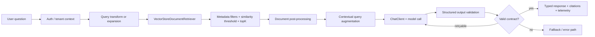

# Spring AI 2.0.1: RAG en Java sin prompts sueltos ni glue code fragil

La mayoria de los demos RAG en Java no fallan porque sea dificil llamar a un modelo. Fallan despues, cuando el demo tiene que convivir con permisos, documentos versionados, tenants, metricas, errores parciales, respuestas mal formadas y un equipo que necesita mantenerlo como cualquier otro sistema Spring.

El problema no es escribir otro prompt. El problema es convertir RAG en una arquitectura gobernable.

Spring AI 2.0.1 es interesante por eso. No porque prometa magia ni porque convierta Java en una copia de LangChain. La propia documentacion lo posiciona de otra manera: llevar al dominio de AI principios del ecosistema Spring como portabilidad, modularidad, POJOs, auto-configuracion, starters, APIs idiomaticas y observabilidad. Para equipos que ya operan Spring Boot, esa diferencia importa mas que el hype.

Un RAG productivo en Spring no deberia ser un metodo gigante que concatena strings, consulta un vector store, llama al modelo y espera que el JSON vuelva bien. Deberia tener piezas separables: ingestion, embeddings, vector store, retriever, filtros por metadata, augmentation, contrato de salida, validacion, retry, fallbacks, observabilidad y evaluacion.

Ese es el angulo practico de Spring AI 2.0.1: usar `ChatClient`, Advisors, `RetrievalAugmentationAdvisor`, retrievers y structured output para mover RAG desde una demo hacia una arquitectura Spring que se pueda revisar, medir y operar.

## Por que los RAGs de demo se rompen

Un demo RAG suele tener este flujo:

1. Recibir una pregunta.
2. Buscar fragmentos parecidos en una base vectorial.
3. Pegar esos fragmentos en un prompt.
4. Llamar al modelo.
5. Mostrar la respuesta.

Eso alcanza para una prueba. No alcanza para produccion.

En produccion aparecen preguntas mas incomodas:

- Que pasa si no hay contexto recuperado?
- Que documentos puede ver este usuario o tenant?
- Como limitamos `topK`, similitud y ruido del contexto?
- Como se audita que fuentes entraron en la respuesta?
- Que hacemos si el modelo devuelve JSON invalido?
- Que parte es retryable y que parte debe fallar rapido?
- Como medimos latencia, tokens, intentos y calidad?
- Donde viven los filtros de metadata: en prompt text o en codigo revisable?

Si esas decisiones quedan escondidas en prompts sueltos, el sistema se vuelve fragil. Spring AI ayuda cuando usamos sus primitivas para hacer explicitas esas decisiones.

## Que aporta Spring AI 2.0.1 sin vender magia

Spring AI 2.0.1 documenta una superficie amplia: APIs portables para modelos de chat, embeddings y vector stores; `ChatClient`; Advisors; structured output; tool/function calling; MCP; observabilidad; ETL de documentos; evaluacion; y starters de Spring Boot.

La parte importante para RAG es que no todo tiene que vivir dentro de un prompt. Spring AI soporta una arquitectura RAG modular con componentes para pre-retrieval, retrieval, document join, post-retrieval y generation. En la practica, eso permite separar decisiones como:

- Transformar o reescribir la query antes de buscar.
- Expandir una query en varias formulaciones.
- Recuperar documentos desde un vector store con umbrales y filtros.
- Filtrar por metadata de forma estatica o dinamica.
- Procesar documentos recuperados antes de pasarlos al modelo.
- Aumentar la query con contexto y decidir que pasa cuando no hay contexto.

Esa modularidad no elimina los riesgos de un LLM. Pero cambia donde se gobiernan. En lugar de tener una cadena de texto imposible de testear, se puede revisar un `Advisor`, un `DocumentRetriever`, un `SearchRequest`, un filtro por metadata y un contrato de salida.

## Arquitectura recomendada

Un flujo RAG Spring AI productivo puede pensarse asi:



La tesis no es que cada proyecto necesite todas esas piezas desde el dia uno. La tesis es que cada pieza importante debe tener un lugar claro. Si el filtro de tenant esta escondido en lenguaje natural, tarde o temprano alguien lo va a romper. Si el contrato de salida solo existe como una frase del prompt, no hay una frontera confiable para el resto del sistema.

## Ejemplo 1: RAG simple con `RetrievalAugmentationAdvisor`

El punto de partida documentado por Spring AI para un flujo RAG modular es `RetrievalAugmentationAdvisor`. Para usarlo, se agrega el modulo `spring-ai-rag`:

```xml
<dependency>
  <groupId>org.springframework.ai</groupId>
  <artifactId>spring-ai-rag</artifactId>
</dependency>
```

Un flujo naive puede verse asi:

```java
import org.springframework.ai.chat.client.ChatClient;
import org.springframework.ai.chat.client.advisor.api.Advisor;
import org.springframework.ai.rag.advisor.RetrievalAugmentationAdvisor;
import org.springframework.ai.rag.retrieval.search.VectorStoreDocumentRetriever;
import org.springframework.ai.vectorstore.VectorStore;

public class RagService {

  private final ChatClient chatClient;
  private final VectorStore vectorStore;

  public RagService(ChatClient.Builder chatClientBuilder, VectorStore vectorStore) {
    this.chatClient = chatClientBuilder.build();
    this.vectorStore = vectorStore;
  }

  public String answer(String question) {
    Advisor advisor = RetrievalAugmentationAdvisor.builder()
        .documentRetriever(VectorStoreDocumentRetriever.builder()
            .vectorStore(vectorStore)
            .similarityThreshold(0.73)
            .topK(5)
            .build())
        .build();

    return chatClient.prompt()
        .advisors(advisor)
        .user(question)
        .call()
        .content();
  }
}
```

Lo relevante no es que el ejemplo sea corto. Lo relevante es que el retrieval ya no es una concatenacion informal. El umbral, `topK` y el vector store son parte de un componente revisable.

## Ejemplo 2: filtros de metadata para permisos y segmentacion

RAG sin metadata es peligroso. En una organizacion real, los documentos tienen tenant, producto, region, clasificacion, version, fecha y estado. Spring AI documenta filtros SQL-like portables para vector stores y filtros dinamicos en `VectorStoreDocumentRetriever`.

```java
import org.springframework.ai.rag.retrieval.search.VectorStoreDocumentRetriever;
import org.springframework.ai.vectorstore.VectorStore;
import org.springframework.ai.vectorstore.filter.FilterExpressionBuilder;

public class TenantAwareRetrieverFactory {

  public VectorStoreDocumentRetriever retrieverFor(VectorStore vectorStore, String tenantId) {
    var filter = new FilterExpressionBuilder()
        .eq("tenant", tenantId)
        .and(new FilterExpressionBuilder().eq("status", "published"))
        .build();

    return VectorStoreDocumentRetriever.builder()
        .vectorStore(vectorStore)
        .similarityThreshold(0.70)
        .topK(6)
        .filterExpression(filter)
        .build();
  }
}
```

El detalle operacional: el filtro no deberia depender de que el modelo "recuerde" obedecer una frase. Debe vivir antes de que el contexto llegue al modelo. El prompt puede explicar como usar el contexto; no debe ser la unica barrera de seguridad.

## Ejemplo 3: contratos de salida sin prometer exactitud semantica

Spring AI structured output permite mapear la salida del modelo a POJOs o records. En 2.0.1, `validateSchema()` activa un loop de validacion y autocorreccion: Spring AI valida la respuesta contra el JSON Schema del tipo objetivo y, si falla, reintenta agregando el error especifico al prompt. La documentacion indica 3 intentos por defecto.

Eso es util, pero hay que decirlo con precision: JSON Schema detecta ciertos errores de forma y tipo. No garantiza que la respuesta sea semanticamente correcta. Y la documentacion dice que streaming no esta soportado cuando `validateSchema()` esta activo, porque el advisor necesita la respuesta completa para validar.

```java
import java.util.List;
import org.springframework.ai.chat.client.ChatClient;

public record SupportAnswer(
    String answer,
    List<String> citedDocumentIds,
    String confidence,
    boolean escalationRequired
) {}

public class SupportAnswerService {

  private final ChatClient chatClient;

  public SupportAnswerService(ChatClient.Builder builder) {
    this.chatClient = builder.build();
  }

  public SupportAnswer answerWithContract(String question, String retrievedContext) {
    return chatClient.prompt()
        .system("""
            Answer only with information present in the provided context.
            If the context is insufficient, set escalationRequired to true.
            Use citedDocumentIds for the source documents you relied on.
            """)
        .user("""
            Question:
            %s

            Context:
            %s
            """.formatted(question, retrievedContext))
        .call()
        .entity(SupportAnswer.class, spec -> spec.validateSchema());
  }
}
```

Este patron le da al resto del sistema una frontera mas limpia: un objeto tipado, campos esperados y un camino de retry cuando la forma no cumple el contrato. Pero sigue siendo responsabilidad del sistema evaluar calidad, citas, cobertura y seguridad.

## Tabla comparativa: tres formas de construir RAG en Java

| Enfoque | Ventaja | Riesgo | Cuando usarlo |
| --- | --- | --- | --- |
| Prompts manuales + glue code | Rapido para explorar | Fragil, dificil de testear, contratos implicitos | Spikes y demos internos de bajo riesgo |
| Spring AI con `ChatClient`, Advisors y RAG modules | Encaja con patrones Spring, separa retrieval/augmentation/contratos | Requiere disenar limites y observabilidad; no elimina fallos del LLM | Equipos Spring que quieren RAG mantenible |
| Framework Python-first externo | Ecosistema AI amplio y rapido | Stack adicional, handoffs entre Java/Python, operacion separada | Equipos con plataforma AI ya consolidada fuera de JVM |

La comparacion honesta no es "Spring AI reemplaza todo". La comparacion correcta es operacional: si tu equipo ya vive en Spring Boot, cuanto gana al mantener AI dentro de sus patrones de configuracion, observabilidad, deployment y governance?

## Production tips para pasar de demo a sistema

1. **No uses el prompt como unica politica de permisos.** Filtra documentos antes de retrieval o durante retrieval con metadata revisable.
2. **Define que significa contexto vacio.** Spring AI documenta que `ContextualQueryAugmenter` por defecto no permite contexto vacio e instruye al modelo a no responder; cambiar eso debe ser una decision explicita.
3. **Separa query transformation de generation.** Para reescritura o expansion de queries, usa baja temperatura y mide impacto en recall/precision.
4. **Registra fuentes y documentos usados.** La respuesta final debe permitir auditoria: IDs, versiones, timestamps o hashes de documentos.
5. **Trata structured output como detector de fallos, no como verdad.** `validateSchema()` ayuda con forma JSON y retry; no prueba que el contenido sea correcto.
6. **Disena fallback desde el principio.** Sin contexto suficiente, fuente ambigua o contrato invalido despues de reintentos debe haber una respuesta segura.
7. **Mide intentos y costo acumulado.** Los retries de validacion consumen tokens y latencia. Un contrato muy rigido puede ser caro si falla frecuentemente.
8. **Evalua con preguntas reales.** No basta con ejemplos felices. Usa preguntas ambiguas, documentos obsoletos, tenants cruzados y casos donde la respuesta correcta es "no se".
9. **No mezcles tool calling sin limites.** Tools/function calling es potente, pero cada tool necesita permisos, timeouts y auditoria y una politica clara de side effects.
10. **Versiona ingestion y embeddings.** Cuando cambia el chunking o el modelo de embeddings, cambia el comportamiento del retrieval. Tratalo como migracion, no como detalle invisible.

## Donde entran tools y MCP

Spring AI tambien documenta tool/function calling y soporte MCP. En una arquitectura RAG, eso abre una puerta importante: no todo tiene que venir del vector store. Algunas respuestas necesitan datos vivos, acciones o APIs internas.

Pero tool calling no deberia ser un atajo para saltarse governance. Si el modelo puede pedir ejecutar una funcion, esa funcion tiene que estar acotada:

- inputs validados;
- permisos del usuario aplicados antes de ejecutar;
- timeouts y circuit breakers;
- logs auditables;
- side effects separados de lecturas;
- salida resumible y segura para el modelo.

Un buen limite practico: el modelo puede decidir que necesita una herramienta, pero la aplicacion decide si esa herramienta se puede ejecutar en ese contexto.

## Checklist de readiness RAG para equipos Spring

Antes de decir que tu RAG esta listo para produccion, revisa esto:

- El retrieval aplica filtros de tenant, producto, estado y clasificacion antes de entregar contexto al modelo.
- `topK`, similarity threshold y estrategia de ranking son configurables y medidos.
- El sistema sabe que hacer cuando no hay contexto recuperado.
- La respuesta incluye referencias o IDs de documentos cuando el caso de uso lo requiere.
- La salida critica tiene contrato tipado y validacion.
- Hay fallback si la validacion falla despues de los reintentos configurados.
- La latencia y token usage incluyen retries, no solo la llamada final exitosa.
- Hay tests con documentos obsoletos, preguntas fuera de scope y conflictos entre fuentes.
- Tool calling, si existe, tiene permisos, timeouts y auditoria.
- El equipo puede explicar que parte esta garantizada por codigo y que parte sigue siendo probabilistica.

## Conclusion

Spring AI 2.0.1 no hace que RAG sea automatico. Esa es la buena noticia.

Lo que ofrece es mas util para equipos Spring: primitives para que RAG deje de ser una bolsa de prompts y pase a tener componentes, contratos y limites operables. `RetrievalAugmentationAdvisor` ayuda a separar retrieval y augmentation. `VectorStoreDocumentRetriever` permite trabajar con umbrales, `topK` y filtros de metadata. Structured output con `validateSchema()` convierte algunos fallos de formato en retries controlados. Observabilidad, evaluacion, tool calling y MCP completan una superficie que encaja con aplicaciones Spring reales.

La pregunta no es si Spring AI reemplaza universalmente a otros frameworks. La pregunta es mas concreta: si tu plataforma ya es Spring Boot, por que tu capa AI deberia vivir fuera de los mismos patrones de configuracion, testing, observabilidad y governance?

Si tu equipo ya tiene una demo RAG, el siguiente paso no es escribir otro prompt. Es convertir esa demo en un contrato operacional.

## Fuentes

- Spring AI project page: https://spring.io/projects/spring-ai
- Spring AI 2.0.1 reference: https://docs.spring.io/spring-ai/reference/
- Spring AI RAG reference: https://docs.spring.io/spring-ai/reference/api/retrieval-augmented-generation.html
- Spring AI Schema Validation & Self-Correction: https://docs.spring.io/spring-ai/reference/api/structured-output/validation.html
