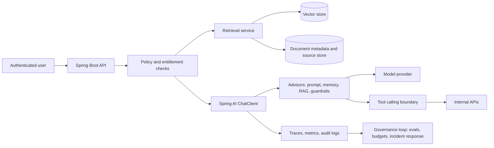

# Spring AI es el puente de Java enterprise hacia agentes gobernados

Los equipos Java estan dejando atras la primera ola de experimentos con chatbots. Las siguientes preguntas son mas operativas: podemos conectar modelos con documentos enterprise sin filtrar datos? Podemos dejar que un modelo llame APIs internas sin crear un camino de automatizacion sin revision? Podemos medir la calidad antes del release, observar fallas despues del release, y pausar un workflow cuando el costo, la latencia o el riesgo cruzan un umbral?

Ahi es donde Spring AI se vuelve estrategicamente util para empresas ya estandarizadas en Java y Spring Boot. Spring AI por si solo no convierte a un modelo en un worker autonomo y seguro. No es una suite completa de gobernanza o seguridad de LLM, ni una frontera de seguridad, ni un sustituto de la evaluacion y la gestion de incidentes. Es un framework de aplicacion que lleva la integracion de AI a los mismos patrones que los equipos Spring ya usan: starters, auto-configuracion, inyeccion de dependencias, abstracciones portables, POJOs, clientes fluidos, advisors, integraciones de observabilidad, soporte de RAG, tool calling, adaptadores de vector store y soporte de MCP.

Esa distincion importa. El camino mas rapido hacia AI productiva en una empresa Java no es fingir que un framework puede resolver la gobernanza. Es usar el framework para que la capa de aplicacion sea consistente, testeable, observable y reemplazable, y luego envolver esa capa con evaluacion, monitoreo, control de accesos, politica de datos, controles de costo y mecanismos de rollback.

La tesis es simple: Spring AI es el puente de Java enterprise hacia agentes gobernados, no una plataforma de gobernanza por si misma.

## Alcance de esta pieza

Esta entrada es deliberadamente acotada. Cubre la **frontera de gobernanza** para workflows de agentes y RAG en Java: que te da Spring AI, que no te da, y que tenes que construir alrededor antes de que el workflow toque datos productive o ejecute acciones mediante tools.

No repite la arquitectura de Spring AI, que esta cubierta en otra pieza de esta serie, ni cubre las operaciones de agentes enterprise y la propiedad de la plataforma, que esta cubierta en otra. El claim de este articulo es el acotado: Spring AI soporta patrones de agentes y RAG a nivel de aplicacion, y la gobernanza de produccion sigue necesitando evals, observabilidad, politicas, controles de costo, model routing y sistemas de rollout y rollback por fuera del framework.

## Por que los equipos Java necesitan un puente

La mayoria de los programas de AI enterprise arrancan con uno de dos prototipos. El primero es un chatbot thin sobre un modelo hosteado. El segundo es un proof of concept de RAG o agentes en Python que funciona en el laboratorio pero que es incomodo de operar junto a los sistemas que son duenos de los datos de clientes, los entitlements, los audit logs y los pipelines de despliegue.

El prototipo puede probar que un LLM puede resumir una politica, clasificar un ticket o redactar una respuesta de soporte. Rara vez prueba que el workflow pueda gobernarse. Los equipos de produccion siguen necesitando responder preguntas mundanas pero decisivas:

- Que documentos se recuperaron, con que filtros de metadata, para que usuario?
- Que tools pudo llamar el modelo, y con que argumentos?
- Que modelo atendio el request, con que perfil de latencia y costo?
- Que evaluaciones tienen que pasar antes de cambiar un prompt, una estrategia de retrieval, una version de modelo o el schema de una tool?
- Que traces y audit logs se retienen, por cuanto tiempo, bajo que politica de acceso?
- Que umbral pausa o revierte el workflow?

Para muchas organizaciones Java, la parte mas dificil no es escribir la primera llamada al modelo. Es meter la AI dentro del modelo operativo que ya usan para las aplicaciones criticas. Spring AI es util porque permite arrancar desde una arquitectura de aplicacion Spring Boot familiar en lugar de crear un stack de AI paralelo, con convenciones desconocidas de ciclo de vida, dependencias, despliegue y observabilidad.

Spring AI describe su objetivo como aplicar al AI engineering principios del ecosistema Spring como portabilidad, diseno modular y POJOs. Su documentacion de referencia plantea el problema de integracion como conectar datos y APIs enterprise con modelos de AI. Ese es exactamente el limite enterprise donde los sistemas de agentes y RAG se vuelven serios.

## Que te da realmente Spring AI

Spring AI ofrece APIs portables para modelos de chat, embeddings, imagen, audio y moderacion, vector stores, converters de structured output, ingesta de documentos, tool y function calling, observabilidad, utilidades de evaluacion de modelos, advisors, chat memory, RAG e integracion con MCP. El valor no es que cada abstraccion sea magicamente neutral entre proveedores en cada detalle de produccion. El valor es que las demandas comunes de una aplicacion de AI se convierten en componentes administrados por Spring y no en scripts sueltos.

Para ingenieros Spring senior, la ergonomia resulta familiar:

- Starters y auto-configuracion conectan clientes de modelos y vector stores al contexto de la aplicacion.
- `ChatClient` ofrece una API fluida, en el mismo spirit que `WebClient` y `RestClient`.
- Los structured outputs mapean respuestas del modelo a tipos de Java.
- Los advisors encapsulan patrones recurrentes de prompt, memoria, retrieval y transformacion.
- El tool calling permite que el modelo pida funciones o tools del lado del cliente.
- Las abstracciones de vector store permiten cambiar de backend de almacenamiento con menos reescritura de la aplicacion.
- RAG y document ETL conectan contenido enterprise con workflows de generacion.
- Los hooks de observabilidad exponen las operaciones de AI al stack de monitoreo.
- Las utilidades de evaluacion dan un punto de partida para chequeos de alucinacion y de calidad de salida.
- El soporte de MCP permite que las aplicaciones Spring consuman servidores MCP o expongan servicios Spring al ecosistema de tools de AI.

Ese conjunto de features alcanza para construir workflows utiles como Q&A de documentacion interna, triaje de tickets, redaccion de respuestas desde una base de conocimiento, busqueda de clausulas contractuales, retrieval para sales enablement o asistentes operativos guiados. Tambien alcanza para meterse en problemas si faltan los controles alrededor.

El modelo mental correcto es: Spring AI estandariza la capa de integracion de la aplicacion. La gobernanza sigue necesitando un sistema alrededor de la aplicacion.

## Arquitectura de referencia: RAG gobernado y tool calling en Spring

Un sistema productivo de agentes o RAG en Java normalmente no es un componente. Es un workflow que une identidad, retrieval, construccion de prompt, invocacion de modelo, ejecucion de tools, logging, evaluacion, monitoreo y rollback.



En esta forma, Spring AI queda en el centro del camino de la aplicacion: `ChatClient`, advisors, retrieval, adaptadores de vector store, clientes de modelos y tool calls. No deberia ser dueno de cada decision de gobernanza. La identidad debe seguir en la capa de identidad enterprise. La autorizacion debe applicarse antes del retrieval y de la ejecucion de tools. La retencion de auditoria debe seguir la politica enterprise. Los presupuestos de costo y latencia se deben medir por workflow. La gestion de incidentes debe vivir en runbooks, alertas y ownership operativo.

La ventaja de usar Spring AI es que este workflow se puede construir como una aplicacion Spring y no como un servicio de AI desligado. Los mismos equipos que conocen Spring Security, la configuracion de Spring Boot, Micrometer, Testcontainers, los gates de CI y los pipelines de despliegue pueden razonar sobre el camino de la AI.

## Ejemplo de codigo: un endpoint RAG gobernado y minimo

El siguiente ejemplo es deliberadamente pequeno. Muestra la forma de un endpoint RAG administrado por Spring, con un chequeo de politica, retrieval con filtros de metadata y una llamada a `ChatClient` trazable. El codigo real de produccion deberia agregar manejo de excepciones mas rico, rate limits, versionado de prompts, eval gates y retencion de auditoria.

```java
package com.example.ai.support;

import java.util.List;

import org.springframework.ai.chat.client.ChatClient;
import org.springframework.ai.document.Document;
import org.springframework.ai.vectorstore.SearchRequest;
import org.springframework.ai.vectorstore.VectorStore;
import org.springframework.web.bind.annotation.PostMapping;
import org.springframework.web.bind.annotation.RequestBody;
import org.springframework.web.bind.annotation.RestController;

@RestController
class SupportAssistantController {

    private final ChatClient chatClient;
    private final VectorStore vectorStore;
    private final EntitlementService entitlements;
    private final AuditLog auditLog;

    SupportAssistantController(
            ChatClient.Builder chatClientBuilder,
            VectorStore vectorStore,
            EntitlementService entitlements,
            AuditLog auditLog) {
        this.chatClient = chatClientBuilder.build();
        this.vectorStore = vectorStore;
        this.entitlements = entitlements;
        this.auditLog = auditLog;
    }

    @PostMapping("/internal/support/answer")
    SupportAnswer answer(@RequestBody SupportQuestion request) {
        entitlements.assertCanAccessAccount(request.userId(), request.accountId());

        List<Document> documents = vectorStore.similaritySearch(SearchRequest.builder()
                .query(request.question())
                .topK(6)
                .filterExpression("accountType == 'enterprise' && region == 'us'")
                .build());

        String context = documents.stream()
                .map(Document::getText)
                .reduce("", (left, right) -> left + "\n---\n" + right);

        String answer = chatClient.prompt()
                .system("You answer support questions from approved context only. "
                        + "If the context is insufficient, say what is missing.")
                .user(user -> user.text("Question:\n{question}\n\nApproved context:\n{context}")
                        .param("question", request.question())
                        .param("context", context))
                .call()
                .content();

        auditLog.recordRagAnswer(request.userId(), request.accountId(), request.question(), documents);
        return new SupportAnswer(answer);
    }
}

record SupportQuestion(String userId, String accountId, String question) {}
record SupportAnswer(String answer) {}

interface EntitlementService {
    void assertCanAccessAccount(String userId, String accountId);
}

interface AuditLog {
    void recordRagAnswer(String userId, String accountId, String question, List<Document> documents);
}
```

La decision de diseno importante no es la sintaxis, es la frontera. El retrieval ocurre despues de los chequeos de entitlement. El filtro de metadata acota el contexto candidato. La instruccion de sistema limita la respuesta al contexto aprobado. Los identificadores de los documentos recuperados se pueden escribir en los audit logs. Esos son controles de aplicacion que hacen posible la evaluacion posterior y el analisis de incidentes.

Aca tambien hay que ser honestos sobre lo que el codigo no prueba. Una instruccion de prompt no es un control de seguridad. Un filtro de metadata es tan bueno como el pipeline de ingesta y la calidad de la metadata que hay detras. Un audit log solo sirve si se retiene, es consultable y esta protegido contra manipulacion.

## Conectando datos y APIs enterprise

El feature set de Spring AI mas relevante para enterprise esta alrededor de conectividad de datos y APIs: document ETL, vector stores, filtros de metadata, structured output, tool calling y MCP.

Para RAG, la ingesta de documentos tiene que tratarse como un producto de datos. Los equipos necesitan ownership claro de parsing, chunking, embeddings, versionado, enriquecimiento de metadata, borrado y reindexacion. La aplicacion tiene que saber que versiones de documento son elegibles para cada usuario y cada workflow. El vector store no puede convertirse en un bypass de permisos.

Para tool calling, el modelo nunca deberia recibir una credencial amplia de API interna ni una superficie de ejecucion libre. Las tools deben ser angostas, tipadas, logueadas y chequeadas por politica. Un buen limite de tools se parece a una API de producto: capacidad nombrada, schema explicito, validacion, idempotencia donde se pueda, autorizacion, rate limits y audit logs.

```java
package com.example.ai.tools;

import org.springframework.ai.tool.annotation.Tool;
import org.springframework.stereotype.Component;

@Component
class OrderTools {

    private final OrderService orders;
    private final EntitlementService entitlements;

    OrderTools(OrderService orders, EntitlementService entitlements) {
        this.orders = orders;
        this.entitlements = entitlements;
    }

    @Tool(description = "Return shipment status for an order the current user is allowed to view")
    ShipmentStatus shipmentStatus(String userId, String orderId) {
        entitlements.assertCanViewOrder(userId, orderId);
        return orders.lookupShipmentStatus(orderId);
    }
}

record ShipmentStatus(String orderId, String carrier, String status, String lastUpdatedAt) {}

interface OrderService {
    ShipmentStatus lookupShipmentStatus(String orderId);
}

interface EntitlementService {
    void assertCanViewOrder(String userId, String orderId);
}
```

MCP agrega otra ruta de integracion importante. Da a las organizaciones un protocolo para exponer tools y contexto a aplicaciones de AI, del lado del cliente y del servidor. En un entorno Spring, el soporte de MCP ayuda a exponer servicios Spring a workflows de AI o a consumir servidores MCP externos. Es util, pero hay que gobernarlo como cualquier otra superficie de integracion. La pregunta no es solo "Puede el modelo descubrir una tool?", es "Quien aprobo esta tool, que datos puede tocar, como se monitorea y como se revoca?".

## La evaluacion es un loop de entrega, no un checkbox de lanzamiento

Spring AI incluye utilidades de evaluacion de modelos para evaluar el contenido generado y proteger contra respuestas alucinadas. Es un punto de partida, no un sistema de calidad completo.

En produccion, la evaluacion deberia ser un loop de entrega que corre antes y despues del release. Un loop util incluye:

- Golden datasets por workflow, con ejemplos representativos faciles, difficult, ambiguos y adversariales.
- Chequeos de retrieval que verifican si se recuperaron los documentos correctos antes de juzgar la calidad de la generacion.
- Chequeos de alucinacion que comparan los claims contra el contexto recuperado o contra APIs autoritativas.
- Tests de regresion para prompts, schemas de tools, versiones de modelo, estrategias de chunking, modelos de embedding y cambios de vector store.
- Uso cauteloso de LLM-as-judge, con calibracion, muestreo y revision humana para workflows de alto impacto.
- Benchmarks de costo y latencia por caso de uso, no por preferencia generica de modelo.
- Release gates que bloquean o exigen revision cuando los indicadores de calidad, costo, latencia o seguridad se regresan.

La discusion de Anthropic sobre evaluacion embedded es util aca como senal sobre la direccion de la industria: la evaluacion se esta volviendo mas continua, mas independiente y mas atada a como se usan realmente los modelos. La discusion de OpenAI sobre safety cases hace enfasis, en el mismo linea, en argumentos respaldados en evidencia, safeguards tecnicos, monitoreo, umbrales, disenso, aprobaciones, pausa, rollback y aprendizaje de incidentes. Esas fuentes hablan del desarrollo de modelos frontier y de sus safeguards, no son una receta directa para cada app RAG enterprise. Pero apuntan al mismo patron operacional: el trabajo serio en AI requiere evidencia explicita, monitoreo, escalamiento y rollback.

Para los equipos de aplicacion, la version practica es mas chica pero igual de rigurosa. Cada workflow de Spring AI deberia tener un contrato de release:

| Gate | Pregunta de ejemplo | Accion de release |
| --- | --- | --- |
| Calidad de retrieval | El workflow recupero los documentos fuente esperados? | Bloquear el release si el recall cae por debajo del umbral acordado para el workflow. |
| Calidad de generacion | Las respuestas estan fundamentadas en el contexto recuperado? | Exigir revision para claims sin soporte o sin lenguaje de incertidumbre. |
| Seguridad de tools | Las tool calls usaron argumentos validos y permisos aprobados? | Bloquear el release ante invocaciones no autorizadas o malformadas. |
| Costo y latencia | La latencia p95 o el costo por tarea superaron el presupuesto? | Enrutar a un modelo mas barato, reducir contexto o pausar el rollout. |
| Monitoreo | Traces, logs, alertas y dashboards estan activos? | Fallar cerrado si el workflow no se puede monitorear. |
| Rollback | Se pueden revertir cambios de prompt, modelo, tool e indice? | No hacer release sin un camino de rollback probado. |

Los mejores suites de evaluacion son aburridos. Corren en CI. estan atados a workflows de producto. Producen trend lines. Atrapan regresiones antes de que una demo se convierta en un incidente de cliente.

## Gobernanza operacional alrededor de Spring AI

La gobernanza operacional es la capa que evita que una aplicacion de AI se convierta en una caja negra sin trazabilidad. Debe disenarse antes de que el workflow maneje datos sensibles o ejecute acciones mediante tools.

La gobernanza minima para un workflow productivo de Spring AI deberia incluir:

- Tracing de llamadas al modelo, retrieval, advisors, tool calls, latencia, errores, uso de tokens y decisiones de model routing.
- Audit logs con identidad de usuario, IDs de fuentes recuperadas, argumentos de invocacion de tools, decisiones de politica y salidas generadas donde lo permita la politica de retencion.
- Controles de datos para clasificacion de documentos, aislamiento por tenant, calidad de metadata, borrado, cifrado y retencion.
- Monitoreo de abuso para patrones de uso inusuales, intentos de prompt injection, intentos de exponer credenciales y secuencias sospechosas de tool calls.
- Runbooks de gestion de incidentes con niveles de severidad, ownership de guardia, controles de pausa, criterios de notificacion al cliente y expectativas de postmortem.
- Controles de presupuesto para gasto de tokens, costos de vector store, jobs de embedding, reintentos y enrutamiento a modelos premium.
- Control de accesos para credenciales de modelos, registro de tools, cambios de prompt, overrides de evals y acceso a traces.
- Umbrales de rollback y pausa para senales de calidad, seguridad, latencia, costo y abuso.

El anuncio de Anthropic sobre Enterprise Frontier Safeguards es relevante porque plantea una tension enterprise concreta: las organizaciones quieren monitoreo fuerte contra el mal uso, pero tambien necesitan control sobre datos sensibles, claves, storage, politicas de acceso y audit logging. Use o no un offering especifico, la leccion de arquitectura aplica en general: los controles de AI enterprise no son solo statements de politica. Son decisiones de data plane y control plane.

El reporte de OpenAI sobre model distillation agrega otra leccion practica: el comportamiento adversarial puede ser coordinado, adaptativo y cross-account. Los equipos de aplicacion enterprise deberian asumir que los prompt injections, la manipulacion de outputs de tools, los intentos de filtrar credenciales y los intentos de extraccion van a evolucionar. La respuesta no puede ser un unico regex. Necesita controles en capas, deteccion, enforcement y comparticion de informacion entre los equipos de seguridad, plataforma y aplicacion.

## Costo y performance son decisiones de arquitectura

Costo y latencia no son un detalle tardio de procurement. Dan forma a la arquitectura de un workflow de AI.

La portabilidad de Spring AI ayuda porque los equipos pueden enrutar entre proveedores y tipos de modelo de forma mas intencional, pero la portabilidad no elimina los tradeoffs. Un workflow puede necesitar un modelo premium para interpretacion legal ambigua, un modelo chico para clasificacion, un modelo de embedding dedicado para retrieval y streaming para el tiempo de respuesta en la interfaz. El diseno correcto depende de valor de negocio, tolerancia a latencia, riesgo y volumen esperado.

Los equipos deberian medir costo y performance por workflow:

- Cual es la latencia p50 y p95 aceptable para este camino de usuario?
- Cual es el costo maximo por tarea de negocio completada?
- Que requests pueden usar un modelo mas barato o una respuesta cacheada?
- Que requests requieren ventanas de contexto mas grandes, mejor retrieval o revision humana?
- Que combinaciones de embeddings y vector store dan calidad de retrieval aceptable a la escala esperada?
- Que contexto conviene resumir, filtrar o descartar antes de invocar al modelo?
- Donde el streaming mejora la latencia percibida sin esconder modos de falla del backend?

El cache puede ayudar con contenido publico estable, clasificaciones repetidas o pasos de retrieval deterministas. Puede ser peligroso cuando las respuestas dependen de entitlements del usuario, datos frescos o contexto regulado. Expandir la ventana de contexto puede mejorar el recall, pero aumenta el costo e introduce material irrelevante. El model routing puede reducir el gasto, pero complica la evaluacion. Cada optimizacion deberia evaluarse contra el workflow real, no contra un benchmark generico.

## Spring AI comparado con las capas de gobernanza

Spring AI se entiende mejor como parte de un stack. Se solapa con algunas concerns de evaluacion y observabilidad, pero no deberia tratarse como el modelo operativo completo.

| Concern | Spring AI ayuda con | Capa adicional que sigue haciendo falta |
| --- | --- | --- |
| Acceso a modelos | APIs portables de chat, embedding, moderacion y proveedores | Revision de riesgo de proveedor, gobernanza de credenciales, politica de routing |
| RAG | Document ETL, abstracciones de vector store, filtros de metadata, advisors | Clasificacion de datos, entitlements, ciclo de vida del indice, garantias de borrado |
| Tool calling | Integracion tipada de tools y funciones, componentes administrados por Spring | Aprobacion de tools, minimo privilegio, rate limits, seguridad transaccional, revision de auditoria |
| Observabilidad | Visibilidad de las operaciones de AI via hooks del framework | SIEM enterprise, alertas, retencion, gestion de incidentes, correlacion de abuso |
| Evaluacion | Utilidades de evaluacion de salida y chequeos de alucinacion | Golden datasets, gates de CI, revision humana, calibracion de LLM-judge, politica de release |
| MCP | Integracion cliente y servidor con el ecosistema de tools de AI | Gobernanza del registro de tools, revocacion, revision de seguridad, ownership entre equipos |
| Gobernanza | Hace el comportamiento de la app mas consistente e inspeccionable | Politicas, controles, aprobaciones, presupuestos, rollback, auditoria, ownership de compliance |

Por eso Spring AI es un puente. Les da a los equipos Java una base de aplicacion coherente. No elimina la necesidad de ingenieria de plataforma y de gobernanza.

## Checklist practico para produccion

Antes de mover un workflow de Spring AI de piloto a produccion, pasalo por un checklist que trate la gobernanza como parte de la entrega.

1. **Define el workflow.**
   Nombra la tarea de negocio, los usuarios, las fuentes de datos, las tools, los criterios de exito, los modos de falla y los owners.

2. **Clasifica los datos.**
   Identifica campos sensibles, registros regulados, limites de tenant, reglas de retencion y requisitos de borrado antes de indexar o promptar.

3. **Cierra el retrieval.**
   Aplica autorizacion antes del retrieval, usa filtros de metadata, loguea los IDs de origen, testea la calidad del retrieval y verifica el comportamiento del borrado.

4. **Angosta las tools.**
   Prefiere tools chicas, tipadas y chequeadas por politica sobre acceso amplio a APIs. Loguea argumentos y resultados. Haz explicitas y revisables las acciones destructivas.

5. **Construye los evals temprano.**
   Crea golden datasets, tests de regresion, chequeos de alucinacion, tests de tool calls y umbrales de release antes del rollout amplio.

6. **Instrumenta el camino.**
   Tracea llamadas al modelo, retrieval, tool calls, routing, uso de tokens, latencia, errores y eventos de seguridad. Asegura que el monitoreo falle cerrado en workflows criticos.

7. **Define presupuestos.**
   Fija presupuestos de costo y latencia por workflow. Decide cuando enrutar, cachear, streamear, degradar, pausar o pedir revision humana.

8. **Gobierna los cambios.**
   Versiona prompts, schemas de tools, estrategias de retrieval, selecciones de modelo y suites de evals. Exige aprobacion para cambios de alto impacto.

9. **Prepara la gestion de incidentes.**
   Define niveles de severidad, controles de pausa, caminos de escalamiento, criterios de notificacion al cliente, retencion de transcripts y ownership del postmortem.

10. **Testea el rollback.**
    Practica revertir cambios de prompt, modelo, indice, tool y routing. Un workflow que no se puede revertir no esta listo para produccion.

## El bottom line

Spring AI importa porque permite que las empresas Java construyan aplicaciones de AI sin abandonar el modelo de ingenieria que ya corre gran parte de su software de negocio. Aporta acceso a modelos, RAG, tool calling, structured outputs, advisors, hooks de observabilidad, utilidades de evaluacion, integracion con vector stores y MCP en patrones familiares de Spring Boot.

Pero los agentes gobernados no los crea un framework por si solo. Los crea la combinacion de ergonomia de framework, limites de aplicacion disciplinados, loops de evaluacion, observabilidad, controles de datos, monitoreo de seguridad, presupuestos, control de accesos y gestion de incidentes.

Para equipos Java senior, la pregunta correcta no es "Puede Spring AI volvernos agentic?". La mejor pregunta es: "Que workflow podemos hacer util, medible, observable, reversible y gobernable?".

Empieza ahi. Toma un workflow de agentes o RAG en Java. Evalualo contra evals, traces, politica de datos, model routing, presupuesto de costo y latencia, y umbrales de rollback. Si faltan esos controles, Spring AI igual te puede ayudar a construir la aplicacion, pero todavia no estas listo para llamarlo gobernado.

## Fuentes

- Pagina del proyecto Spring AI: https://spring.io/projects/spring-ai
- Documentacion de referencia de Spring AI: https://docs.spring.io/spring-ai/reference/
- Anthropic, "Partnering with Accenture on embedded evaluation": https://www.anthropic.com/news/accenture-embedded-evaluation
- Anthropic, "Developing Enterprise Frontier Safeguards with our customers": https://www.anthropic.com/news/enterprise-frontier-safeguards
- OpenAI, "Towards safety cases for frontier AI training": https://openai.com/index/towards-safety-cases-for-frontier-ai-training/
- OpenAI, "Disrupting a coordinated model-distillation campaign": https://openai.com/index/disrupting-a-coordinated-model-distillation-campaign/

_Los anuncios de Anthropic y OpenAI se citan como senales sobre la direccion de la industria, no como prueba neutral de eficacia. Este articulo no presenta metricas de adopcion ni numeros de benchmark._
